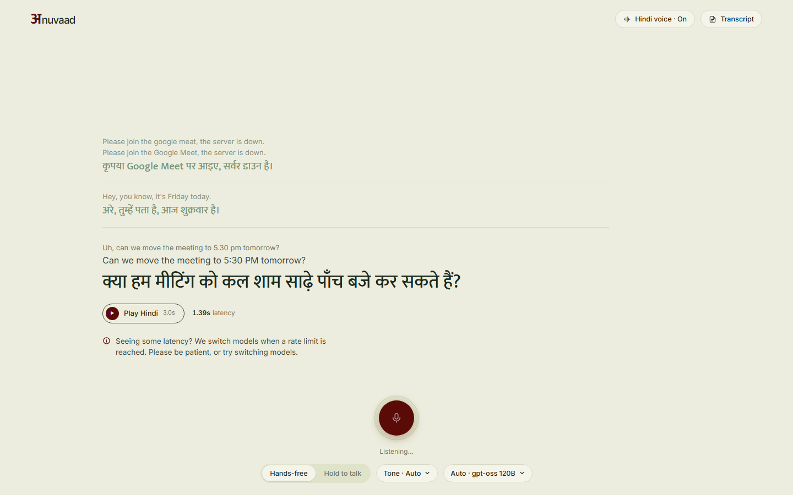
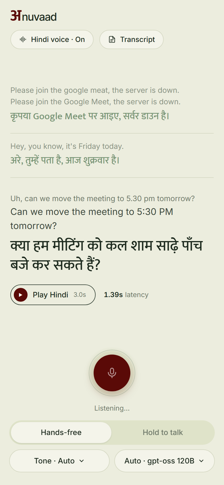
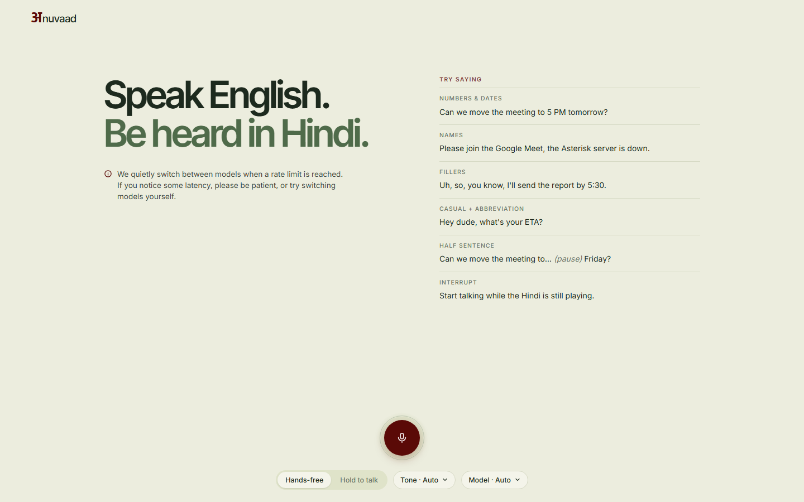
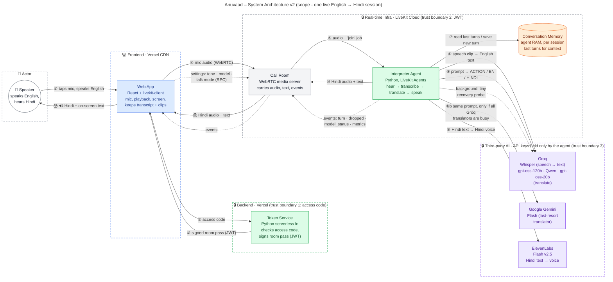
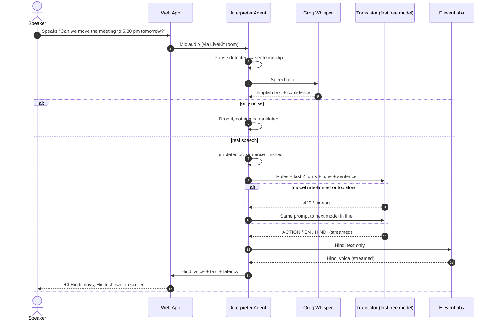
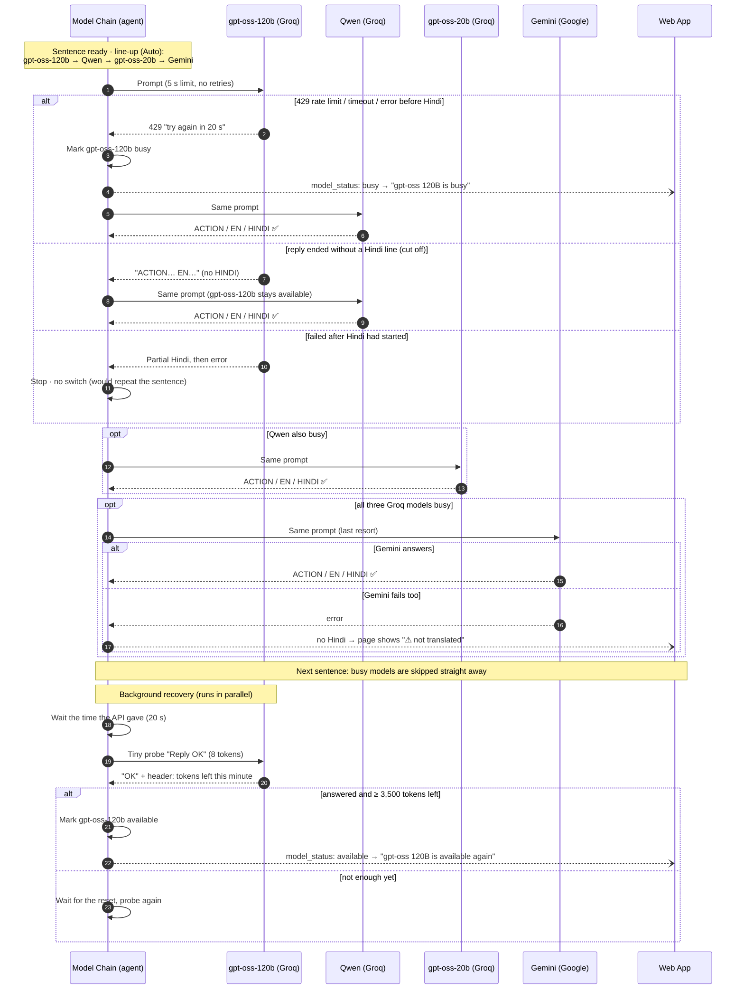

# Anuvaad (अनुवाद): Live English → Hindi Voice Interpreter

Speak English, hear natural spoken Hindi about **1.2–2 seconds** later. **Live demo:** [anuvaadx.vercel.app](https://anuvaadx.vercel.app) (access code shared separately).

| Web | Mobile |
|---|---|
|  |  |

<details><summary>Start screens</summary>

| Web | Mobile |
|---|---|
|  |  |

</details>

*Conversation screenshots use sample lines.*

## Architecture



- **Web App** (Vercel) captures the mic and plays the Hindi. The **Token Service** only lets people with the access code in.
- **LiveKit Cloud** carries the audio and runs the **Interpreter Agent**, which calls Groq, Gemini and ElevenLabs. API keys never reach the browser.

## How it Works



1. A voice detector cuts each sentence when you pause. Groq Whisper turns it into English, and pure noise is dropped.
2. A turn detector waits a moment if the sentence sounds unfinished.
3. One LLM call does everything: it cleans the English, picks the tone (आप/तुम), and writes Hindi with numbers and times spelled the way they are said.
4. Only the Hindi line is sent to ElevenLabs, which starts speaking while the rest is still arriving.

### Edge cases

| Case | Handling |
|---|---|
| Accents, mis-heard words | Translates what was *meant* ("google meat" → Google Meet) |
| Names | Brands stay in English letters; people and places in Devanagari |
| Half sentences | Waits longer; a fragment is completed on the next turn |
| Fillers, noise | Dropped; filler-only or noise turns are not spoken |
| Tone | आप / तुम picked from the words, or set from the menu |
| Numbers, times | Said the Hindi way: 5:30 → साढ़े पाँच, 1:30 → डेढ़, $5.30 → पाँच डॉलर तीस सेंट |
| Questions to the bot | Translated, never answered |
| Interruptions | Talking over the Hindi stops it |
| Rate limits | Automatic model fallback, plus a "slow down" hint on the page |

## Data Pipeline

```mermaid
---
title: Anuvaad – Speech-to-Speech Pipeline
---
flowchart LR
    subgraph IN["Input"]
        A1["🎙️ English speech<br/>browser mic, echo/noise cleaned"]
    end

    subgraph PRE["Preprocessing"]
        B1["Voice detection<br/>cut clip after 0.45 s silence"]
        B2["Speech → text<br/>Groq Whisper + noise filter"]
        B3["End-of-turn check<br/>finished? wait 0.8 s · unsure ≤ 2.5 s"]
    end

    subgraph PROC["Processing"]
        C1["Prompt build<br/>rules + last 2 turns + tone"]
        C2["Translate<br/>gpt-oss-120b → Qwen → gpt-oss-20b → Gemini"]
        C3["Reply check<br/>keep Hindi line, skip noise turns"]
    end

    subgraph OUT["Output"]
        D1["🔊 Hindi voice<br/>ElevenLabs stream"]
        D2["🖥️ Screen<br/>English + Hindi + latency"]
    end

    A1 -- "audio stream" --> B1
    B1 -- "speech clip" --> B2
    B2 -- "English text" --> B3
    B3 -- "complete sentence" --> C1
    C1 -- "prompt" --> C2
    C2 -- "ACTION / EN / HINDI" --> C3
    C3 -- "Hindi text" --> D1
    C3 -- "English + Hindi" --> D2

    classDef in fill:#dbeafe,stroke:#2563eb,color:#1e3a8a
    classDef pre fill:#f3f4f6,stroke:#6b7280,color:#111827
    classDef proc fill:#dcfce7,stroke:#16a34a,color:#14532d
    classDef out fill:#ede9fe,stroke:#7c3aed,color:#4c1d95
    class A1 in
    class B1,B2,B3 pre
    class C1,C2,C3 proc
    class D1,D2 out
```



### Model fallback (the Translate stage)



- Each free model has its own rate limit, so taking turns keeps translation going when one is busy.
- A busy model is skipped until a tiny probe shows it is free again, so the full prompt is never re-sent just to check.
- In the page, **Auto** follows this order and shows the model answering right now. Picking a model puts it first.

## Tech Stack

| Layer | Technology |
|---|---|
| Frontend | React + Vite, `livekit-client`, hosted on Vercel |
| Token API | Python serverless function on Vercel (`web/api/token.py`) |
| Real-time + agent | LiveKit Cloud, LiveKit Agents (Python 3.11), Silero VAD, LiveKit turn detector |
| Speech to text | Groq Whisper large-v3-turbo |
| Translation (LLM) | Groq gpt-oss-120b · Qwen 3.8 27B · gpt-oss-20b, Google Gemini Flash (fallback) |
| Hindi voice | ElevenLabs Flash v2.5 |
| Tests | pytest (fake LLM, no API keys needed) |

## Setup / Run

**1. Keys.** Create `.env` in the project root:

```env
LIVEKIT_URL=wss://<your-project>.livekit.cloud
LIVEKIT_API_KEY=...
LIVEKIT_API_SECRET=...
GROQ_API_KEY=...
ELEVEN_API_KEY=...
GOOGLE_API_KEY=...        # optional: Gemini as last-resort translator
ACCESS_CODE=...           # optional: page then needs ?code=<ACCESS_CODE>
```

Optional tuning: `LLM_FALLBACK_ORDER` (default `gpt-oss-120b,qwen,gpt-oss-20b,gemini`), `GEMINI_MODEL`, `MIN_ENDPOINT_DELAY`, `MAX_ENDPOINT_DELAY`.

**2. Agent** (Python 3.11):

```bash
python -m venv .venv && source .venv/bin/activate   # Windows: .venv\Scripts\activate
pip install -r requirements.txt
python -m translator.agent download-files           # VAD + turn-detector models
python -m translator.agent dev                      # joins rooms on your LiveKit project
```

**3. Web page** (two terminals):

```bash
python -m uvicorn server:app --port 8000            # token API on :8000
cd web && npm install && npm run dev                # page on :5173, proxies /api to :8000
```

Open `http://localhost:5173/?code=<ACCESS_CODE>`, tap the mic and speak English.

**4. Tests:** `pytest`

**5. Deploy:**

```bash
lk agent deploy                                     # agent → LiveKit Cloud (keys via `lk agent update-secrets`)
cd web && vercel deploy --prod                      # page + token API → Vercel (set LIVEKIT_*, ACCESS_CODE there)
```
