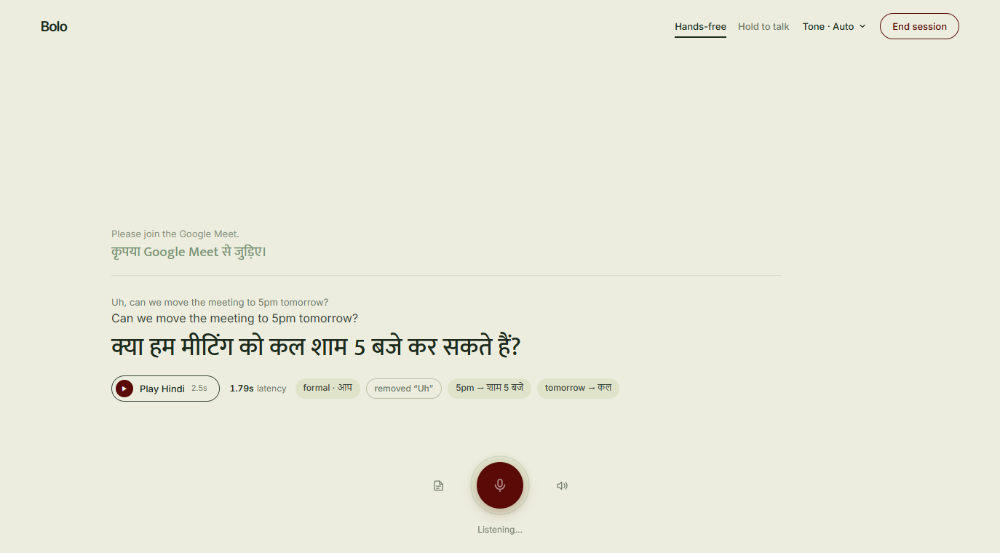

# Bolo: Live English → Hindi Voice Interpreter

**Live demo:** [live-hindi-interpreter.vercel.app](https://live-hindi-interpreter.vercel.app). The access code is shared separately, so the API credits aren't open to everyone.

Speak English and hear it in natural Hindi a moment later. Bolo listens to live speech, understands what was meant, translates it into everyday spoken Hindi, and speaks it out loud. It takes about **1.2–2 seconds** from the end of a sentence to the first Hindi audio.

## How it works

Bolo works like an assembly line, and every step starts before the previous one has finished:

1. **Listen.** The browser streams the microphone (with echo cancellation) over WebRTC through LiveKit.
2. **Know when a sentence is done.** Voice-activity detection and an end-of-sentence model decide when the speaker has finished, so half sentences aren't translated too early.
3. **Transcribe.** Whisper (large-v3 turbo, on Groq) turns the speech into English text, guided by a list of names it should spell correctly.
4. **Clean up.** Fillers, noise, mis-heard names and speech-to-text glitches are removed or fixed. Times, dates, money and abbreviations get Hindi hints.
5. **Translate.** A large language model (gpt-oss-120b on Groq) translates into natural, office-style Hindi in the right tone, and does nothing but translate.
6. **Speak.** ElevenLabs Flash v2.5 says the Hindi aloud. Before speaking, numbers and times are rewritten the way a Hindi speaker says them.
7. **Show.** The page shows the English, the Hindi, a replay button, the time taken, and what was handled on each line.

## How each edge case is handled

| Edge case | What Bolo does |
|---|---|
| **Strong accents, fast speech** | Whisper is given the important names in advance, and common mis-hearings are corrected ("google meat" → Google Meet). The translator is told the text came from speech recognition and translates what the speaker *meant*, not the exact mistakes. |
| **Named entities** ("Google Meet", "Asterisk") | Known names are locked before translation, so they can never be translated, and the Hindi grammar around them still fits ("Google Meet पर"). Other names follow a simple rule: company, product and app names stay in English letters (Zendesk, Razorpay), and people and places are written in Hindi (Priya → प्रिया, Mumbai → मुंबई). |
| **Partial sentences** | The end-of-sentence model waits longer after "…move the meeting to". A sentence that ends on a dangling word is held and joined with what follows. If the speaker really stops, the held part is translated anyway after a short pause. |
| **Fillers** ("uh", "you know") | They are removed before translation, without touching real words ("I like pizza" stays). A turn that is only fillers is not spoken at all. |
| **Noise and silence** | Speech recognition sometimes invents words on background noise ("Thank you.", "Me. Me. Me."). These are detected and skipped, and the page shows why. Hindi speech is skipped too, since the input is English. |
| **Latency buildup** | Every step streams into the next, translation starts before the sentence is fully confirmed, fast models are used, and the prompt stays short. The time to first Hindi audio is shown on every line. |
| **Formal vs casual tone** | Words like "sir, kindly" or "hey dude, gonna" decide between आप and तुम. Formal is the default, the safe choice in Hindi. The tone menu can also force either. |
| **Numbers, dates, abbreviations** | Times are said the Hindi way: 5:30 → साढ़े पाँच, 10:15 → सवा दस, 2:45 → पौने तीन, 1:30 → डेढ़, 2:30 → ढाई. Also 5 PM → शाम 5 बजे, ₹1,500 → एक हज़ार पाँच सौ रुपये, 20% → बीस प्रतिशत, 3.75 करोड़ → पौने चार करोड़, ETA → पहुँचने का अनुमानित समय, HR → एचआर. The screen keeps the digits, and only the voice uses the words. |
| **Interruptions** | Echo cancellation keeps the Hindi playback out of the microphone. If the speaker talks over the Hindi, playback stops (barge-in), and the line is marked "interrupted". |
| **The model answering instead of translating** | The translator is strictly instructed that it is not an assistant, with examples, so a question like "What time is it?" is translated rather than answered. |

## Using it

Listening never starts on its own. First tap the mic (or **Start session**) and allow the microphone. Then:

- **Hands-free** (default): just talk; a short pause ends each sentence.
- **Hold to talk**: hold the mic button (or the Space bar) while speaking. Good for noisy rooms.
- **Tone**: Auto, Formal (आप) or Casual (तुम).
- **Replay and download**: every Hindi line has a ▶ Play button. The icons beside the mic download the transcript and the full Hindi audio.

Headphones give the cleanest experience.

## Speed

| Step | Typical time |
|---|---|
| Knowing the sentence has ended | 0.4–0.6 s |
| Speech to English text | 0.2–0.4 s |
| First words of the translation | 0.3–0.5 s |
| First Hindi audio | 0.2–0.3 s |
| **End of speech → first Hindi audio** | **≈ 1.2–2 s** |

Measured on the live deployment:

| Spoken English | Hindi | Total |
|---|---|---|
| "Uh, can we move the meeting to 5 PM tomorrow?" | क्या हम मीटिंग को कल शाम 5 बजे कर सकते हैं? | **1.4–1.8 s** |
| "The meeting is at 5:30 pm today." | मीटिंग आज शाम साढ़े 5 बजे है। (spoken: साढ़े पाँच) | **1.2 s** |
| "Please join the Google Meet, the Asterisk server is down." | कृपया Google Meet में जुड़िए, Asterisk सर्वर डाउन है। | **1.9 s** |

## Quality checks

- **Automated tests** cover all the edge-case rules: fillers, names, times and numbers, partial sentences, noise, and the spoken-Hindi rewriting.
- **A translation check** runs tricky sentences through the real translator.
- **A listening check** turns 20 tricky sentences into real Hindi audio, so pronunciation can be judged by ear, before and after each fix.

## Built with

LiveKit Agents (real-time audio and turn-taking) · Groq Whisper (speech to text) · Groq gpt-oss-120b (translation) · ElevenLabs Flash v2.5 (Hindi voice) · Vercel (web page) · LiveKit Cloud (agent hosting). Every service runs on its free tier.

## Known limitations and next steps

- Translation happens per sentence, not word by word. That's deliberate: Hindi puts the verb at the end, so it needs the whole sentence.
- Hinglish (Hindi spoken in English words) works, but speech recognition is tuned for English, so accuracy varies.
- Speech recognition is the slowest step. A streaming speech-to-text service would save about half a second.
- Next ideas: phone-call support, and separate voices for different speakers in a group call.
