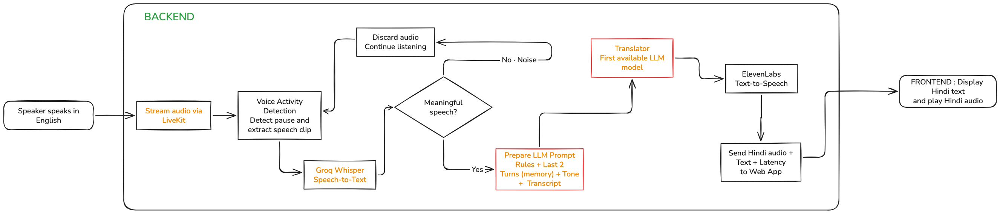
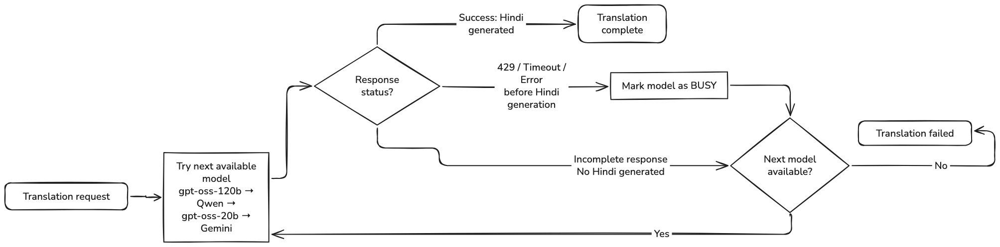
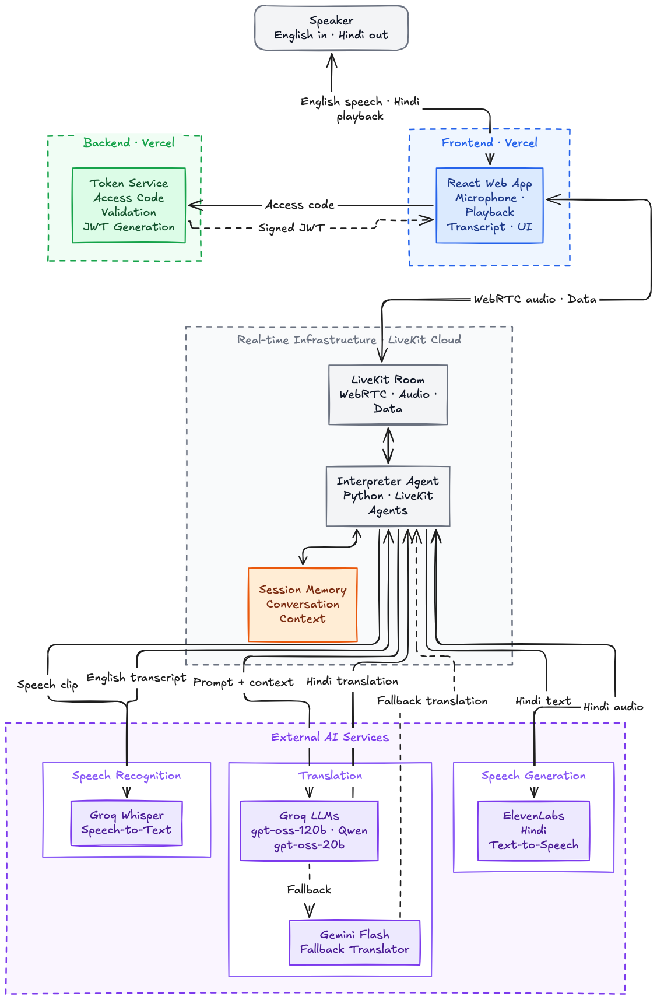
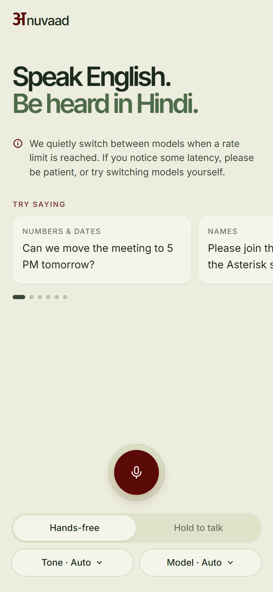

# Anuvaad (अनुवाद): Live English → Hindi Voice Interpreter

**Live demo:** [anuvaadx.vercel.app](https://anuvaadx.vercel.app/?code=gnani-w2j03n)

Speak English, hear natural spoken Hindi about **1.2–2 seconds** later. Anuvaad transcribes your speech, translates it with an LLM that writes Hindi the way it is *spoken*, and reads it out loud.

## Workflow

1. The speaker's audio streams to the backend through LiveKit.
2. Voice activity detection cuts a clip when the speaker pauses, and Groq Whisper turns it into English text.
3. Noise is discarded; meaningful speech goes on.
4. The LLM prompt is built from the rules, the last 2 turns, the tone and the transcript.
5. The first available model translates it, and ElevenLabs speaks the Hindi.
6. The web app shows the Hindi text and plays the Hindi audio, with the latency.

## Model Fallback Logic

- Models are tried in order: **gpt-oss-120b → Qwen → gpt-oss-20b → Gemini**.
- A rate limit (429), timeout or error before any Hindi marks the model **busy** and the next one is tried in the same turn.
- A reply with no Hindi line goes straight to the next model. If no model is left, the line shows "not translated".
- A busy model is retried later with a tiny probe instead of the full prompt.

## Architecture

- **Frontend** (React on Vercel): microphone, Hindi playback, transcript and controls.
- **Backend** (Vercel): checks the access code and signs a LiveKit token.
- **LiveKit Cloud**: carries the audio and runs the Interpreter Agent, which keeps the session memory.
- **External AI**: Groq Whisper (speech to text), Groq LLMs with Gemini as fallback (translation), ElevenLabs (Hindi voice). API keys stay on the agent.

## Edge cases

| Case | Handling |
|---|---|
| Accents, mis-heard words | Translates what was *meant* ("google meat" → Google Meet) |
| Names | Brands stay in English letters; people and places in Devanagari |
| Half sentences | Waits longer; a fragment is completed on the next turn |
| Fillers, noise | Dropped; filler-only or noise turns are not spoken |
| Tone | आप / तुम picked from the words, or set from the menu |
| Numbers, times | Said the Hindi way: 5:30 → साढ़े पाँच, 1:30 → डेढ़, $5.30 → पाँच डॉलर तीस सेंट |
| Questions to the bot | Translated, never answered |
| Interruptions | Talking over the Hindi stops it |
| Rate limits | Automatic model fallback, plus a "slow down" hint on the page |

**Built with:** LiveKit Agents & Cloud · Groq (Whisper, gpt-oss, Qwen) · Google Gemini · ElevenLabs Flash v2.5 · React + Vite on Vercel.

## Screenshots

| Web · conversation | Mobile · start |
|---|---|
|  |  |

*The web screenshot uses sample lines.*
